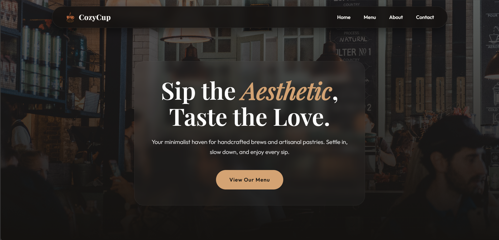
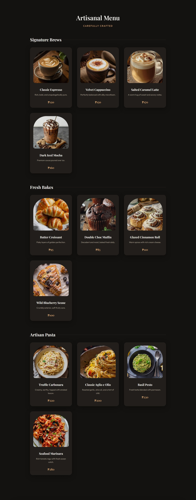
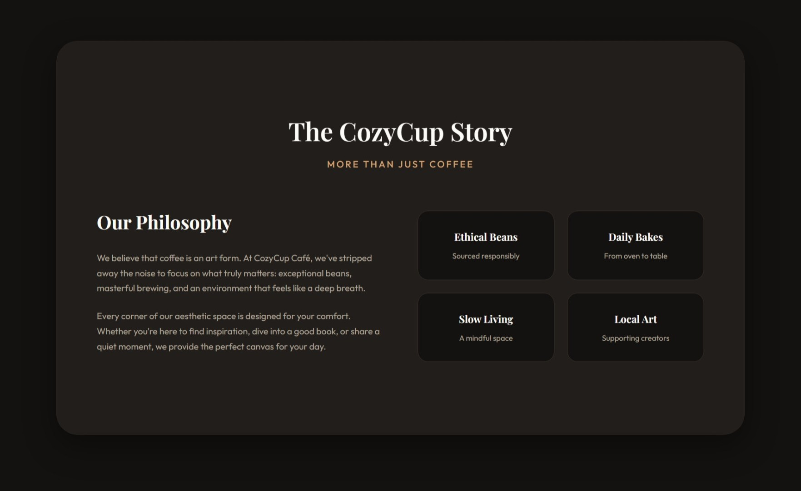
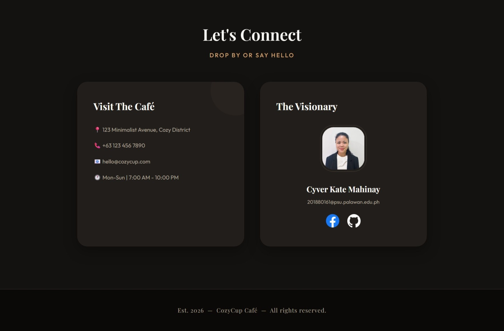

# Cozy Cup Cafe ☕

### Project Description
Cozy Cup Cafe is a simple café website designed to showcase the café's menu, ambiance, and brand identity. It provides visitors with a clean, modern, and user-friendly browsing experience across different devices.

### Features
* Clean and cozy café-themed user interface
* Responsive design for desktop and mobile devices
* Menu section featuring food and drink offerings
* Easy-to-use navigation
* Modern and minimalist layout

## Screen Captures

**Homepage** – Showcases the café's welcoming atmosphere and branding.

**Menu Page** – Displays the available food and beverage selections.

**About Page** – Introduces the café's story, mission, and vision.

**Contact Page** – Provides contact information and ways to reach the café.

## 👤 About the Authors

 

*Name:* **Cyver Kate Mahinay**  
*Email:* [201880161@psu.palawan.edu.ph](mailto:201880161@psu.palawan.edu.ph)  
*Contact with Cyver:* 
 
 

